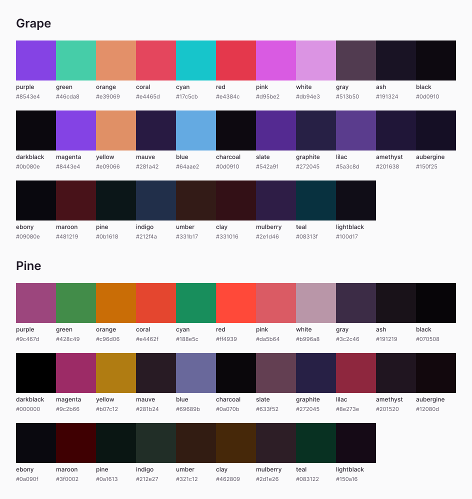

# Zitchdog
A minimal purple-based soothing colorscheme (for neovim and much more!) inspired by [daltonmenezes/aura-theme](https://github.com/daltonmenezes/aura-theme/), but with different palettes and added variants!

## Theme Variants

<details open>
	<summary>Variant: <b>Grape</b></summary>
</br>


</details>

<details open>
	<summary>Variant: <b>Pine</b></summary>
	</br>


</details>

<details>
	<summary>Some extra screenshots (see more below)</summary>
	</br>


</details>

## Features

- Multiple theme variants.
- Supports tons of major plugins.
- Provides [support](https://github.com/theamallalgi/zitchdog/tree/main/extras) for numerous other applications.
- Does not have an accursed light mode.

<details>
<summary>List of supported plugins</summary>
</br>

<!-- plugins:start -->

| Plugin | Source |
| --- | --- |
| [aerial.nvim](https://github.com/stevearc/aerial.nvim) | [`aerial`](lua/zitchdog/groups/aerial.lua) |
| [ale](https://github.com/dense-analysis/ale) | [`ale`](lua/zitchdog/groups/ale.lua) |
| [alpha-nvim](https://github.com/goolord/alpha-nvim) | [`alpha`](lua/zitchdog/groups/alpha.lua) |
| [barbar.nvim](https://github.com/romgrk/barbar.nvim) | [`barbar`](lua/zitchdog/groups/barbar.lua) |
| [blink.cmp](https://github.com/Saghen/blink.cmp) | [`blink`](lua/zitchdog/groups/blink.lua) |
| [bufferline.nvim](https://github.com/akinsho/bufferline.nvim) | [`bufferline`](lua/zitchdog/groups/bufferline.lua) |
| [nvim-cmp](https://github.com/hrsh7th/nvim-cmp) | [`cmp`](lua/zitchdog/groups/cmp.lua) |
| [codeium.nvim](https://github.com/Exafunction/codeium.nvim) | [`codeium`](lua/zitchdog/groups/codeium.lua) |
| [copilot.lua](https://github.com/zbirenbaum/copilot.lua) | [`copilot`](lua/zitchdog/groups/copilot.lua) |
| [nvim-dap](https://github.com/mfussenegger/nvim-dap) | [`dap`](lua/zitchdog/groups/dap.lua) |
| [dashboard-nvim](https://github.com/nvimdev/dashboard-nvim) | [`dashboard`](lua/zitchdog/groups/dashboard.lua) |
| [flash.nvim](https://github.com/folke/flash.nvim) | [`flash`](lua/zitchdog/groups/flash.lua) |
| [fzf-lua](https://github.com/ibhagwan/fzf-lua) | [`fzf`](lua/zitchdog/groups/fzf.lua) |
| [vim-gitgutter](https://github.com/airblade/vim-gitgutter) | [`gitgutter`](lua/zitchdog/groups/gitgutter.lua) |
| [gitsigns.nvim](https://github.com/lewis6991/gitsigns.nvim) | [`gitsigns`](lua/zitchdog/groups/gitsigns.lua) |
| [glyph-palette.vim](https://github.com/lambdalisue/glyph-palette.vim) | [`glyph-palette`](lua/zitchdog/groups/glyph-palette.lua) |
| [grug-far.nvim](https://github.com/MagicDuck/grug-far.nvim) | [`grug-far`](lua/zitchdog/groups/grug-far.lua) |
| [headlines.nvim](https://github.com/lukas-reineke/headlines.nvim) | [`headlines`](lua/zitchdog/groups/headlines.lua) |
| [hop.nvim](https://github.com/phaazon/hop.nvim) | [`hop`](lua/zitchdog/groups/hop.lua) |
| [vim-illuminate](https://github.com/RRethy/vim-illuminate) | [`illuminate`](lua/zitchdog/groups/illuminate.lua) |
| [indent-blankline.nvim](https://github.com/lukas-reineke/indent-blankline.nvim) | [`indent-blankline`](lua/zitchdog/groups/indent-blankline.lua) |
| [indentmini.nvim](https://github.com/nvimdev/indentmini.nvim) | [`indentmini`](lua/zitchdog/groups/indentmini.lua) |
| [lazy.nvim](https://github.com/folke/lazy.nvim) | [`lazy`](lua/zitchdog/groups/lazy.lua) |
| [leap.nvim](https://github.com/ggandor/leap.nvim) | [`leap`](lua/zitchdog/groups/leap.lua) |
| [lspsaga.nvim](https://github.com/glepnir/lspsaga.nvim) | [`lspsaga`](lua/zitchdog/groups/lspsaga.lua) |
| [mini.animate](https://github.com/echasnovski/mini.animate) | [`mini_animate`](lua/zitchdog/groups/mini_animate.lua) |
| [mini.clue](https://github.com/echasnovski/mini.clue) | [`mini_clue`](lua/zitchdog/groups/mini_clue.lua) |
| [mini.completion](https://github.com/echasnovski/mini.completion) | [`mini_completion`](lua/zitchdog/groups/mini_completion.lua) |
| [mini.cursorword](https://github.com/echasnovski/mini.cursorword) | [`mini_cursorword`](lua/zitchdog/groups/mini_cursorword.lua) |
| [mini.deps](https://github.com/echasnovski/mini.deps) | [`mini_deps`](lua/zitchdog/groups/mini_deps.lua) |
| [mini.diff](https://github.com/echasnovski/mini.diff) | [`mini_diff`](lua/zitchdog/groups/mini_diff.lua) |
| [mini.files](https://github.com/echasnovski/mini.files) | [`mini_files`](lua/zitchdog/groups/mini_files.lua) |
| [mini.hipatterns](https://github.com/echasnovski/mini.hipatterns) | [`mini_hipatterns`](lua/zitchdog/groups/mini_hipatterns.lua) |
| [mini.icons](https://github.com/echasnovski/mini.icons) | [`mini_icons`](lua/zitchdog/groups/mini_icons.lua) |
| [mini.indentscope](https://github.com/echasnovski/mini.indentscope) | [`mini_indentscope`](lua/zitchdog/groups/mini_indentscope.lua) |
| [mini.jump](https://github.com/echasnovski/mini.jump) | [`mini_jump`](lua/zitchdog/groups/mini_jump.lua) |
| [mini.map](https://github.com/echasnovski/mini.map) | [`mini_map`](lua/zitchdog/groups/mini_map.lua) |
| [mini.notify](https://github.com/echasnovski/mini.notify) | [`mini_notify`](lua/zitchdog/groups/mini_notify.lua) |
| [mini.operators](https://github.com/echasnovski/mini.operators) | [`mini_operators`](lua/zitchdog/groups/mini_operators.lua) |
| [mini.pick](https://github.com/echasnovski/mini.pick) | [`mini_pick`](lua/zitchdog/groups/mini_pick.lua) |
| [mini.starter](https://github.com/echasnovski/mini.starter) | [`mini_starter`](lua/zitchdog/groups/mini_starter.lua) |
| [mini.statusline](https://github.com/echasnovski/mini.statusline) | [`mini_statusline`](lua/zitchdog/groups/mini_statusline.lua) |
| [mini.surround](https://github.com/echasnovski/mini.surround) | [`mini_surround`](lua/zitchdog/groups/mini_surround.lua) |
| [mini.tabline](https://github.com/echasnovski/mini.tabline) | [`mini_tabline`](lua/zitchdog/groups/mini_tabline.lua) |
| [mini.test](https://github.com/echasnovski/mini.test) | [`mini_test`](lua/zitchdog/groups/mini_test.lua) |
| [mini.trailspace](https://github.com/echasnovski/mini.trailspace) | [`mini_trailspace`](lua/zitchdog/groups/mini_trailspace.lua) |
| [nvim-navic](https://github.com/SmiteshP/nvim-navic) | [`navic`](lua/zitchdog/groups/navic.lua) |
| [neo-tree.nvim](https://github.com/nvim-neo-tree/neo-tree.nvim) | [`neo-tree`](lua/zitchdog/groups/neo-tree.lua) |
| [neogit](https://github.com/TimUntersberger/neogit) | [`neogit`](lua/zitchdog/groups/neogit.lua) |
| [neotest](https://github.com/nvim-neotest/neotest) | [`neotest`](lua/zitchdog/groups/neotest.lua) |
| [noice.nvim](https://github.com/folke/noice.nvim) | [`noice`](lua/zitchdog/groups/noice.lua) |
| [nvim-notify](https://github.com/rcarriga/nvim-notify) | [`notify`](lua/zitchdog/groups/notify.lua) |
| [nvim-tree.lua](https://github.com/kyazdani42/nvim-tree.lua) | [`nvim-tree`](lua/zitchdog/groups/nvim-tree.lua) |
| [octo.nvim](https://github.com/pwntester/octo.nvim) | [`octo`](lua/zitchdog/groups/octo.lua) |
| [rainbow-delimiters.nvim](https://github.com/HiPhish/rainbow-delimiters.nvim) | [`rainbow`](lua/zitchdog/groups/rainbow.lua) |
| [render-markdown.nvim](https://github.com/MeanderingProgrammer/render-markdown.nvim) | [`render-markdown`](lua/zitchdog/groups/render-markdown.lua) |
| [nvim-scrollbar](https://github.com/petertriho/nvim-scrollbar) | [`scrollbar`](lua/zitchdog/groups/scrollbar.lua) |
| [snacks.nvim](https://github.com/folke/snacks.nvim) | [`snacks`](lua/zitchdog/groups/snacks.lua) |
| [vim-sneak](https://github.com/justinmk/vim-sneak) | [`sneak`](lua/zitchdog/groups/sneak.lua) |
| [supermaven-nvim](https://github.com/supermaven-inc/supermaven-nvim) | [`supermaven`](lua/zitchdog/groups/supermaven.lua) |
| [telescope.nvim](https://github.com/nvim-telescope/telescope.nvim) | [`telescope`](lua/zitchdog/groups/telescope.lua) |
| [nvim-treesitter-context](https://github.com/nvim-treesitter/nvim-treesitter-context) | [`treesitter-context`](lua/zitchdog/groups/treesitter-context.lua) |
| [trouble.nvim](https://github.com/folke/trouble.nvim) | [`trouble`](lua/zitchdog/groups/trouble.lua) |
| [vimwiki](https://github.com/vimwiki/vimwiki) | [`vimwiki`](lua/zitchdog/groups/vimwiki.lua) |
| [which-key.nvim](https://github.com/folke/which-key.nvim) | [`which-key`](lua/zitchdog/groups/which-key.lua) |
| [yanky.nvim](https://github.com/gbprod/yanky.nvim) | [`yanky`](lua/zitchdog/groups/yanky.lua) |

<!-- plugins:end -->

</details>

<details>
<summary>List of extra applications</summary>
</br>

<!-- extras:start -->

| Tool | Extra |
| --- | --- |
| [Alacritty](https://github.com/alacritty/alacritty) | [extras/alacritty](extras/alacritty) |
| [Fish](https://fishshell.com/docs/current/index.html) | [extras/fish](extras/fish) |
| [Fish Themes](https://fishshell.com/docs/current/interactive.html#syntax-highlighting) | [extras/fish_themes](extras/fish_themes) |
| [Fzf](https://github.com/junegunn/fzf) | [extras/fzf](extras/fzf) |
| [Ghostty](https://github.com/ghostty-org/ghostty) | [extras/ghostty](extras/ghostty) |
| [GNOME Terminal](https://gitlab.gnome.org/GNOME/gnome-terminal) | [extras/gnome_terminal](extras/gnome_terminal) |
| [iTerm](https://iterm2.com/) | [extras/iterm](extras/iterm) |
| [Kitty](https://sw.kovidgoyal.net/kitty/conf.html) | [extras/kitty](extras/kitty) |
| [Lazygit](https://github.com/jesseduffield/lazygit) | [extras/lazygit](extras/lazygit) |
| [Lua Table](https://www.lua.org) | [extras/lua](extras/lua) |
| [Sublime Text](https://www.sublimetext.com/docs/themes) | [extras/sublime](extras/sublime) |
| [Terminator](https://gnome-terminator.readthedocs.io/en/latest/config.html) | [extras/terminator](extras/terminator) |
| [Termux](https://termux.dev/) | [extras/termux](extras/termux) |
| [Tmux](https://github.com/tmux/tmux/wiki) | [extras/tmux](extras/tmux) |
| [Vimium](https://vimium.github.io/) | [extras/vimium](extras/vimium) |
| [WezTerm](https://wezfurlong.org/wezterm/config/files.html) | [extras/wezterm](extras/wezterm) |
| [Windows Terminal](https://aka.ms/terminal-documentation) | [extras/windows_terminal](extras/windows_terminal) |
| [Yazi](https://github.com/sxyazi/yazi) | [extras/yazi](extras/yazi) |

<!-- extras:end -->

</details>

## Requirements
- Neovim: Version >= 0.8.0
- Patched Nerd Font(s) for glyph support (for extras)

## Installation

Using `vim.pack`
```lua
-- vim.pack (Neovim 0.12+)
vim.pack.add({
  { src = "https://github.com/theamallalgi/zitchdog" },
})
```

Using [folke/lazy.nvim](https://github.com/folke/lazy.nvim)
```lua
{
  "theamallalgi/zitchdog",
  lazy = false,
  priority = 1000,
}
```
Using [wbthomason/packer.nvim](https://github.com/wbthomason/packer.nvim)
```vim
use "theamallalgi/zitchdog"
```

Using [junegunn/vim-plug](https://github.com/junegunn/vim-plug)
```vim
Plug "theamallalgi/zitchdog"
```

## Usage
Currently there are 2 available variants - `zitchdog-grape`, `zitchdog-pine`

`require("zitchdog")` loads `lua/zitchdog/init.lua`, the module's entrypoint. It exposes two functions:

* `setup(opts)` merges your table into the config defaults using `vim.tbl_deep_extend("force", ...)`. It only updates config in memory, it does not touch the editor.
* `load(opts)` is what actually applies the colorscheme. If `opts` is passed, it calls `setup(opts)` internally first, then builds the palette for the configured variant and sets every highlight group.

So `load({ variant = "pine" })` is really `setup({ variant = "pine" })` followed by `load()`. Calling `load()` alone just applies whatever is currently sitting in config, either the hardcoded defaults or whatever a prior setup() left behind.

> [!NOTE]
> If you're loading zitchdog via `colorscheme zitchdog-<variant>` instead of calling `load()` directly, call `setup()` with your config before that command runs. The `colors/` files just call `load()` with a hardcoded variant and nothing else, so anything you want applied has to already be in config by then.

Set the Colorscheme in your `init.lua` file or a specific plugin file etc.

```lua
-- To load the default theme (grape)
require("zitchdog").load()

-- To load a specific theme
require("zitchdog").load({ variant = "pine" })
```

### Further Configuration

```lua
-- Default configuration
require("zitchdog").setup({
	variant = "grape", -- "grape" | "pine": the default colorscheme variant
  transparent_bg = false, -- boolean: toggles a transparent background
	disable_cursorline = false, -- boolean: hides CursorLine highlight by matching it to bg
  italic_comments = false, -- boolean: toggles italic comments
  fg = nil, -- string?: override the base foreground (defaults to the variant's white)
  bg = nil, -- string?: override the base background (defaults to the variant's black; ignored when transparent_bg = true)
  colors = {}, -- table<string, string>: override any specific palette color, e.g. { red = "#ff0000", purple = "#a277ff" }
})

-- To change the theme, you can use the `variant` option:
require("zitchdog").setup({
  variant = "pine",
})

-- Or load the theme directly:
require("zitchdog").load({ variant = "pine" })
```

Some plugins need extra configuration to work with **zitchdog**.

<details open>
	<summary>Click here for more information</summary>

#### 1. Get proper colors in [nvim-lualine/lualine.nvim](https://github.com/nvim-lualine/lualine.nvim)

```lua
-- your lualine config file?
require('lualine').setup {
  options = {
    -- rest of your lualine config
    theme = 'auto', -- or 'zitchdog-grape/pine'
    -- rest of your lualine config
  }
}
```

</details>

### Palette API

You can read the active variant's palette through `require("zitchdog.colors")` and use it to define your own highlight groups, for example to style third-party plugins like `bufferline.nvim` or `tabby.nvim`.

```lua
local palette = require("zitchdog.colors").setup()
vim.api.nvim_set_hl(0, "CustomHighlight", { fg = palette.purple, bg = palette.amethyst })
```

* `setup(opts)` returns a copy of the palette of the currently active variant, including any `fg`, `bg` and `colors` overrides from your config. Editing the returned table does not affect the colorscheme.
* `opts.variant` is optional and reads a specific variant regardless of the active one, e.g. `setup({ variant = "pine" })`.
* `get(opts)` is an alias of `setup(opts)`.

> [!NOTE]
> The palette is a snapshot taken when you call it, and loading a colorscheme clears custom highlight groups. Define your groups inside a `ColorScheme` autocmd so they follow variant switches:

```lua
vim.api.nvim_create_autocmd("ColorScheme", {
	pattern = "zitchdog-*",
	callback = function()
		local p = require("zitchdog.colors").setup()
		vim.api.nvim_set_hl(0, "CustomHighlight", { fg = p.purple, bg = p.amethyst })
	end,
})
```



#### To see every available color and its value for the active variant, run:

```vim
:lua print(vim.inspect(require("zitchdog.colors").setup()))
```

<details>
<summary>Available colors and hex codes</summary>
</br>

| Name | Grape | Pine |
| --- | --- | --- |
| `purple` | `#8543e4` | `#9c467d` |
| `green` | `#46cda8` | `#428c49` |
| `orange` | `#e39069` | `#c96d06` |
| `coral` | `#e4465d` | `#e4462f` |
| `cyan` | `#17c5cb` | `#188e5c` |
| `red` | `#e4384c` | `#ff4939` |
| `pink` | `#d95be2` | `#da5b64` |
| `white` | `#db94e3` | `#b996a8` |
| `gray` | `#513b50` | `#3c2c46` |
| `ash` | `#191324` | `#191219` |
| `black` | `#0d0910` | `#070508` |
| `darkblack` | `#0b080e` | `#000000` |
| `magenta` | `#8443e4` | `#9c2b66` |
| `yellow` | `#e09066` | `#b07c12` |
| `mauve` | `#281a42` | `#281b24` |
| `blue` | `#64aae2` | `#69689b` |
| `charcoal` | `#0d0910` | `#0a070b` |
| `slate` | `#542a91` | `#633f52` |
| `graphite` | `#272045` | `#272045` |
| `lilac` | `#5a3c8d` | `#8e273e` |
| `amethyst` | `#201638` | `#201520` |
| `aubergine` | `#150f25` | `#12080d` |
| `ebony` | `#09080e` | `#0a090f` |
| `maroon` | `#481219` | `#3f0002` |
| `pine` | `#0b1618` | `#0a1613` |
| `indigo` | `#212f4a` | `#212e27` |
| `umber` | `#331b17` | `#321c12` |
| `clay` | `#331016` | `#462809` |
| `mulberry` | `#2e1d46` | `#2d1e26` |
| `teal` | `#08313f` | `#083122` |
| `lightblack` | `#100d17` | `#150a16` |

These are the base values. Overrides from `colors`, `fg` and `bg` in your config are applied on top of them.

</details>

## Gallery

<details open>
	<summary>Some screenshots of the `Grape` variant</summary>
	</br>


</details>

<details open>
	<summary>Some screenshots of the `Pine` variant</summary>
	</br>


</details>

> [!NOTE]
> 🦑  more cool stuff is on the way, see ya soon!
